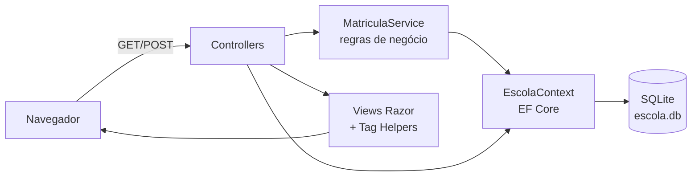

# ASP.NET Core MVC com Entity Framework Core — Cursos de Extensão

[](https://github.com/edufurlanetti/dotnet-aspnet-core-mvc/actions/workflows/ci.yml)

Aplicação web **ASP.NET Core 8 MVC** para gerir **cursos de extensão, alunos e matrículas**. Ela usa **Entity Framework Core** com **SQLite**, telas Razor com **Bootstrap 5**, validação no servidor e no navegador, e testes automatizados com banco real em memória.

> Material da disciplina de Desenvolvimento Web com .NET (ADS) — Prof. Eduardo Furlanetti.

## Funcionalidades

- **Painel** com indicadores: cursos ativos, alunos, matrículas ativas, receita prevista e cursos quase lotados.
- **Cursos**: CRUD completo, busca por nome, filtro por área, barra de ocupação. Um curso com histórico é **desativado** em vez de excluído.
- **Alunos**: cadastro com validação de e-mail único e histórico de cursos.
- **Matrículas**: matrícula com controle de **vagas** e de **duplicidade**, conclusão com nota e cancelamento, que libera a vaga.

## Arquitetura MVC




## Como executar

Requisito: [.NET SDK 8](https://dotnet.microsoft.com/download).

```bash
dotnet run --project src/EscolaMvc
```

Acesse <http://localhost:5080>. Na primeira execução, o banco `escola.db` é criado com cursos, alunos e matrículas de exemplo. Para recomeçar do zero, apague o arquivo.

### Testes

```bash
dotnet test
```

Os testes de `MatriculaServiceTests` usam **SQLite em memória**: as consultas do EF Core são realmente traduzidas para SQL e executadas, com um banco novo para cada teste.

## Conceitos praticados

| Tema | Onde |
|---|---|
| Rotas convencionais, *actions* GET/POST, padrão **Post/Redirect/Get** | `Controllers/` |
| `[Bind]` contra *overposting*, `[ValidateAntiForgeryToken]` | `CursosController`, `AlunosController` |
| `DbContext`, `DbSet`, **Fluent API** (índice único, conversão de enum, `DeleteBehavior`) | `Data/EscolaContext.cs` |
| `Include`/`ThenInclude`, `AsNoTracking`, `EF.Functions.Like` | `Controllers/` |
| Regras de negócio fora do controller, com resultado tipado | `Services/MatriculaService.cs` |
| DataAnnotations com mensagens em português e validação *unobtrusive* | `Models/`, `_ValidationScriptsPartial` |
| ViewModels, *partial views*, `TempData`, `ViewBag`, `SelectList` | `ViewModels/`, `Views/` |
| Tag Helpers (`asp-for`, `asp-items`, `asp-validation-for`, `asp-route-*`) | `Views/` |
| Testes com SQLite em memória | `tests/` |

## Evoluções sugeridas

1. Trocar `EnsureCreated` por **Migrations** (`dotnet ef migrations add Inicial`).
2. Adicionar login com **ASP.NET Core Identity**, com perfis Secretaria e Aluno.
3. Paginar as listas e exportar a lista de matriculados em CSV.
4. Trocar o SQLite por **SQL Server** (veja o repositório [`banco-de-dados-sqlserver`](https://github.com/edufurlanetti/banco-de-dados-sqlserver)).

## Licença

[MIT](LICENSE)
